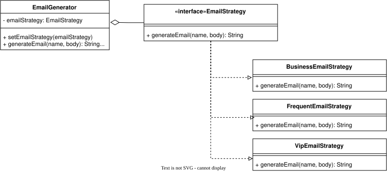

| CS-665       | Software Design & Patterns |
|--------------|----------------------------|
| Name         | Laya Dang                  |
| Date         | 11/03/2026                 |
| Course       | Fall 2026                  |
| Assignment # | 3.                         |

# Assignment Overview

The goal of this assignment is to implement a solution to put together different email templates depending on different customer types (returning, frequent, VIP, etc.). Users should be able to select the target customer segment, enter their name, the message to send, and the program will put together what the email should look like.

There is a simple CLI to demonstrate this implementation! Run `make start` to get started.

## Prerequisites

This project requires:

- Java 25 JDK
- Apache Maven 3.9 or newer

# GitHub Repository Link

https://github.com/pd03-cs-665/cs-665-assignment-3

# Implementation Description 

> Explain the level of flexibility in your implementation, including how new object types can be easily added or removed in the future.

This assignment utilizes the strategy design pattern to ensure flexibility and maintainability. This design pattern allows the different email strategies the be decoupled from the context class that selects the strategy. To add a new strategy (i.e. to account for a new type of customer), we will only need to implement another concrete `EmailStrategy` interface and provide the `generateEmail` method, without having to modify the `EmailGenerator` context class. Similarly with removing a class, because `EmailGenerator` only depends on the generic `EmailStrategy` interface, it would not affect other parts of the code.

> Discuss the simplicity and understandability of your implementation, ensuring that it is easy for others to read and maintain.

This assignment uses the basic structure of the strategy design pattern, with the strategy interface being `EmailStrategy` and the context class being `EmailGenerator`. The folder structure puts all the concrete strategies together (under `strategy/`), making it simple to update, add, or remove a strategy. Because each strategy only has one responsibility (for one customer segment), it is easier to maintain and test as developers need less context to modify an email. template.

This decoupling could add a layer of complexity, however, as the strategy must be initialized or set first before running the main logic `generateEmail`. The direct stack trace may only trace back to the context `EmailGenerator` but not the specific implementation. Although this adds some complexity (more than simple if/else chains), this organization is worthwhile if the application grows in the future.

> Describe how you have avoided duplicated code and why it is important.

Instead of multiple if/else chains that check for customer type when building an email template, each template for each customer segment lives in its own class. This avoids duplicated checks for which customer type the user selected, and the strategy is only set once. Avoiding duplicated code is important, in this case, as we do not want to accidentally modify multiple other customer segment when updating just one template.

> If applicable, mention any design patterns you have used and explain why they were chosen.

This assignment uses the strategy design pattern, as this allows for switching similar variations of an algorithm (in this case, putting together an email) at runtime. This pattern helps avoid large if/else chains and instead allow each variation to be its own concrete class.

# UML Diagram



# Maven Commands

We'll use Apache Maven to compile and run this project.

## Start

```bash
mvn clean compile
mvn exec:java
```

## Compile

```bash
mvn clean compile
```

## JUnit Tests

```bash
mvn clean test
```

## Spotbugs 

```bash
mvn spotbugs:gui
```

## Checkstyle 

```bash
mvn checkstyle:checkstyle
```
